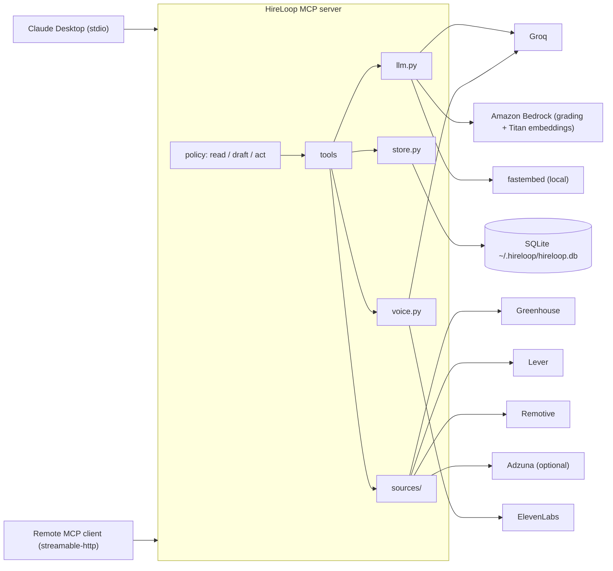

# HireLoop

**An MCP server that runs your whole job hunt inside Claude: find roles, see how well you fit, prepare, practise the interview, and get a plan to close the gaps. Your career data is stored only on your machine.**

Built for wHACKiest 2026, Track 1: *Make MCP Matter: Less Magic, More Utility*.

## The problem

Job hunting is fragmented. The same search is repeated on many sites, duplicate listings waste time, every role needs a fresh resume rewrite, and you rarely know which missing skill is costing you the most offers. Interview practice and application tracking live in yet more tools, and none of them learn from each other. HireLoop puts the loop in one place, behind controls you can see and trust.

## The loop: Find → Fit → Prepare → Practise → Improve

| Step | What happens | Feeds the next step by |
|---|---|---|
| **Find** | `search_jobs` queries Greenhouse, Lever, Remotive (and Adzuna if configured) in parallel, strips HTML and removes duplicates. | Saving every job locally. |
| **Fit** | `rank_fit` shortlists by embedding similarity, then an LLM scores each job 0-100 and explains it in two plain sentences. `skill_gap` ranks the skills you lack by how many good jobs need them. | Storing scores and missing skills. |
| **Prepare** | `tailor_application` rewrites resume bullets and a cover letter for one job, without inventing experience. | Using the profile and the job's gaps. |
| **Practise** | `start_mock_interview` asks spoken questions built from the job and your gaps; `submit_answer` grades each answer against a rubric. | Recording weak topics. |
| **Improve** | `build_plan` turns skill gaps and weak interview answers into a day-by-day plan, highest impact first. | Pointing you at what to learn; once your profile is updated, `rank_fit` rescores everything. |

The feedback loop is the point: interview scores reshape the plan, and the plan and updated profile reshape the next round of fit scores. See [docs/architecture.md](docs/architecture.md).

> **Status:** all three phases are implemented: 10 tools, 3 resources, the `weekly_job_review` prompt, Bedrock grading and embeddings behind `USE_BEDROCK`, and a token-protected remote HTTP transport. Bedrock and the container image have been tested with stubs and locally only, not against a live AWS account (see [docs/deploy-apprunner.md](docs/deploy-apprunner.md)).

## Architecture



Full diagram and request path: [docs/architecture.md](docs/architecture.md).

## Control policy

Every tool has one tier, shown at the top of its docstring so the model (and you) can see it.

| Tool | Tier | What it does |
|---|---|---|
| `build_profile` | **act** (needs `confirm`) | Extracts your profile from a resume. Without `confirm` it only previews; saving needs `confirm=true`. |
| `search_jobs` | **read** | Searches public sources and de-duplicates. Caches results locally. |
| `rank_fit` | **read** | Scores and explains the fit of jobs against your profile. |
| `skill_gap` | **read** | Ranks missing skills across your best-fit jobs. |
| `tailor_application` | **draft** | Resume bullets and cover letter for review. Never invents experience; flags gaps. |
| `start_mock_interview` | **draft** | Generates questions (and optional audio). |
| `submit_answer` | **act** | Grades your answer and stores the result. Takes no `confirm`: submitting your own answer is the explicit action. |
| `build_plan` | **draft** (saving needs `confirm`) | Day-by-day prep plan. |
| `track_pipeline` | **act** (needs `confirm`) | Updates application status. |
| `pipeline_summary` | **read** | Counts, follow-ups due, silent applications. |

- **read**: no side effects. **draft**: produces text for you to review. **act**: writes to your stored data and refuses unless `confirm=true` (the one exception is `submit_answer`, see above). `build_plan` is a draft until you confirm, and the plan that gets saved is exactly the one you were shown.
- Failures (provider down, no profile yet, bad input) come back as a clear message, never a crash.

### Why there's no auto-apply

HireLoop finds, ranks and drafts; **you** apply. An agent that submits applications can embarrass you with a wrong resume, spam employers, or break a site's rules, and the cost lands on you. Keeping a human on the final step is a deliberate control, not a missing feature.

### Privacy

All your data (resume, profile, scores, interviews) is **stored** in a local SQLite file at `~/.hireloop/hireloop.db` (change with `HIRELOOP_DB_PATH`); there is no HireLoop cloud account or server. To do the AI work, the text a task needs is sent to the providers you configure:

| Data | Sent to | When |
|---|---|---|
| Resume, profile, job text | Groq (and Amazon Bedrock if `USE_BEDROCK=true`) | profile, fit, tailoring, questions, grading, plan |
| Interview question text | ElevenLabs | only if voice is configured |
| Your recorded answer audio | Groq Whisper | only if you submit an audio file |

Job data comes from public APIs only; there is no scraping of LinkedIn, Naukri or Indeed. Remote hosting (App Runner) moves storage into your AWS account; see the deployment guide.

## Sponsor usage

- **ElevenLabs**: the mock interviewer's voice. Each question is rendered to an mp3 in `~/.hireloop/audio/` and the path returned. Without keys, the interview falls back to text. Your spoken answers are transcribed with Groq Whisper.
- **AWS**: Amazon Bedrock grades interview answers (Converse API) and produces Titan text embeddings for fit scoring; the server can be hosted as a remote MCP on App Runner ([deployment guide](docs/deploy-apprunner.md)). Everything is opt-in: with `USE_BEDROCK=false`, or no AWS credentials, or a Bedrock error, HireLoop falls back to Groq and local `fastembed`, logs that it did, and `submit_answer` reports which model graded (`graded_by`). No AWS account is needed to run the project.

## Setup

Requires Python 3.11+ and a free [Groq API key](https://console.groq.com). Voice interviews also need an [ElevenLabs](https://elevenlabs.io) API key and voice ID (optional: text mode works without).

```powershell
cd hireloop
python -m venv .venv
.\.venv\Scripts\python -m pip install -e ".[local,voice]"
copy .env.example .env      # then add GROQ_API_KEY (and ELEVENLABS_* for voice)
```

macOS/Linux: `source .venv/bin/activate && pip install -e ".[local,voice]" && cp .env.example .env`.

`[local]` installs `fastembed` for on-device embeddings; `[voice]` installs the ElevenLabs client (skip it for text-only interviews); `[aws]` adds Bedrock support; `[dev]` adds the test tools. The first run downloads a ~90 MB model in the background; if it is unavailable, HireLoop falls back to a basic built-in embedding so it still works (with lower-quality shortlisting).

Run the tests:

```powershell
.\.venv\Scripts\python -m pip install -e ".[dev]"
.\.venv\Scripts\python -m pytest
```

### Connect to Claude Desktop (stdio)

Open **Settings → Developer → Edit Config** and add (adjust the paths):

```json
{
  "mcpServers": {
    "hireloop": {
      "command": "C:\\path\\to\\hireloop\\.venv\\Scripts\\python.exe",
      "args": ["-m", "server.main"],
      "env": { "PYTHONPATH": "C:\\path\\to\\hireloop" }
    }
  }
}
```

Restart Claude Desktop. Secrets are read from `hireloop/.env`, so none go in this file. Logs go to stderr (stdout is reserved for the protocol).

### Remote (streamable HTTP)

```powershell
.\.venv\Scripts\python -m server.main --transport streamable-http --host 0.0.0.0 --port 8000
```

or set `HIRELOOP_TRANSPORT=streamable-http`. The endpoint is `/mcp`, with an open `/health` for load balancers.

- **Auth:** set `HIRELOOP_AUTH_TOKEN`; clients send `Authorization: Bearer <token>`. The server **refuses to start** on a non-loopback host without a token, because it exposes your career data.
- **Bedrock:** `pip install -e ".[aws]"`, then set `USE_BEDROCK=true`, `BEDROCK_MODEL_ID` and (optionally) `BEDROCK_EMBED_MODEL_ID`. Credentials come from the usual AWS chain (env, profile or an instance role).
- **Hosting:** see [docs/deploy-apprunner.md](docs/deploy-apprunner.md) and the `Dockerfile`. Note the remote mode is single-user, and SQLite on App Runner is ephemeral.

## Example conversation

*Illustrative: company names and numbers are examples, not real output.*

> **You:** Here's my resume: *[paste]*. I want backend roles in Bangalore or remote.
>
> **Claude:** *(calls `build_profile`, preview)* Here's what I extracted: Backend engineer, ~4 years, skills: Python, Django, PostgreSQL, AWS, Docker… Should I save this?
>
> **You:** Add Kafka, then save it.
>
> **Claude:** *(calls `build_profile` with `confirm=true`)* Saved locally. Searching now… *(calls `search_jobs`)* Found 38 unique jobs across Greenhouse, Lever and Remotive (11 duplicates removed).
>
> **You:** Which fit me best?
>
> **Claude:** *(calls `rank_fit`)* Top match, 82/100: Senior Backend Engineer at Databricks. You match on Python, AWS and distributed systems, but it asks for Kubernetes and Go experience, which your resume doesn't show…
>
> **You:** What should I learn first?
>
> **Claude:** *(calls `skill_gap`)* Kubernetes is missing from 7 of your 10 best-fit jobs, then Go (4 of 10).
>
> **You:** Tailor my resume for the Databricks one, then interview me for it.
>
> **Claude:** *(calls `tailor_application`)* Five bullets and a cover letter, drafted from your real experience. I flagged Kubernetes as a gap rather than claiming it. *(calls `start_mock_interview`)* Interview ready, with audio for each question. First question: "Walk me through how you'd design a rate limiter…"
>
> **You:** *(answers aloud, saves a recording)* Here's my answer: `C:\recordings\q1.m4a`
>
> **Claude:** *(calls `submit_answer`)* Technical 4, structure 2, clarity 4, relevance 5. You never gave the result of your last project, so the STAR answer ends without an outcome. Weak topic noted: "STAR results".
>
> **You:** Make me a plan for next week.
>
> **Claude:** *(calls `build_plan`)* Draft 7-day plan: Kubernetes basics first (needed by 7 of 10 jobs), then STAR practice (weak in 3 of 4 answers)… Save it?
>
> **You:** Yes. I applied to Databricks today.
>
> **Claude:** *(calls `build_plan` and `track_pipeline` with `confirm=true`)* Saved. Marked as applied; I'll flag a follow-up on the 1st.

Run the guided version any time with the `weekly_job_review` prompt.

## Resources and prompt

| URI / name | Contents |
|---|---|
| `hireloop://profile` | Your saved profile (resume body omitted) |
| `hireloop://pipeline` | Tracked applications and status |
| `hireloop://plan/latest` | Your most recently saved prep plan |
| prompt `weekly_job_review` | Walks you through search → rank → gaps → plan → follow-ups |

## Project layout

```
server/        main.py (FastMCP app) · models.py · store.py · llm.py · policy.py · config.py · http_app.py (auth)
Dockerfile · docs/deploy-apprunner.md
server/tools/  profile.py · search.py · fit.py · tailor.py · interview.py · plan.py · pipeline.py
server/voice.py  ElevenLabs TTS + Groq Whisper STT
server/sources/ greenhouse.py · lever.py · remotive.py · adzuna.py · companies.yaml
tests/         dedupe · policy · store · scoring/parse · phase 2 tools (stubbed LLM)
docs/          architecture.md
```

`companies.yaml` lists the Greenhouse/Lever boards searched. Every token was checked against the live API; boards that returned nothing were dropped. Add your own company by its board slug.

## Roadmap

- **Next:** run the App Runner deployment end to end; DynamoDB behind `store.py` so remote data persists (and per-user profiles); interview audio in S3 so voice works remotely; OAuth instead of a shared bearer token.
- **Later:** a React client over the same server.
