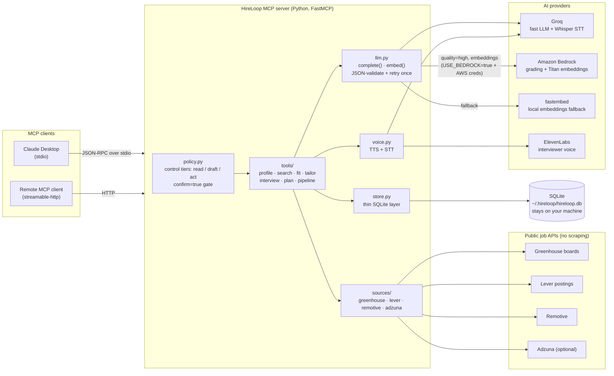
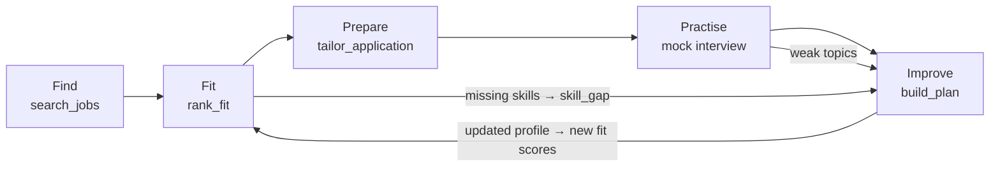

# HireLoop architecture

Provider routing in `llm.py`: `quality="fast"` always goes to Groq. `quality="high"` (interview grading) and embeddings go to Bedrock when `USE_BEDROCK=true`, a model id is set and AWS credentials exist. Otherwise, or if Bedrock errors at runtime, they fall back to Groq / local `fastembed`, and the fallback is logged. Stored job embeddings are tagged with their backend and recomputed if it changes, because vectors from different models are not comparable.

Remote mode wraps the same server in `http_app.py`: bearer-token auth, an open `/health`, and a refusal to start on a non-loopback host without a token. See [deploy-apprunner.md](deploy-apprunner.md).

## The feedback loop

Everything flows through one SQLite database, so each step reads what the previous one wrote.

## Request path: `rank_fit`

1. Load the saved profile and the job ids from the latest `search_jobs`.
2. **Stage 1 (cheap):** embed the profile and each job; cosine similarity picks a shortlist of `top_n + 5`.
3. **Stage 2 (LLM):** one batched call per 6 jobs returns score, matched skills, missing skills and a 2-sentence explanation. The reply is validated with pydantic and retried once if malformed.
4. Scores are saved to `fit_scores`. They are reused until the profile changes, so updating your profile triggers fresh scoring.
5. `skill_gap` later aggregates `missing_skills` from the stored scores.

## Design decisions

| Decision | Reason |
|---|---|
| Only public APIs, no scraping | Legitimate, stable, and avoids ToS violations. |
| Control tiers in code (`policy.py`), not just docs | The `act` tier is enforced, so tests can prove no tool writes without confirmation. |
| `build_profile` preview, then confirm | The user sees exactly what will be stored. The preview is cached, so the saved profile is the one shown. |
| Single `llm.py` | Swapping Groq/Bedrock/embedding providers touches one file. |
| Cache trimmed jobs, not raw payloads | Greenhouse boards with `content=true` are several MB each. |
| Source failures are isolated | One API being down returns a partial result with a clear note, never a crash. |
| Local SQLite behind `store.py` | Privacy by default; DynamoDB can replace the class later. |

## Request path: mock interview

1. `start_mock_interview` builds a question mix (technical / behavioural / gap-targeted) from the job description, your profile and the `missing_skills` stored by `rank_fit`. ElevenLabs renders each question to `~/.hireloop/audio/`; if voice is not configured or a clip fails, the interview continues in text.
2. `submit_answer` takes text, or an audio file that is transcribed with Groq Whisper (only real audio extensions up to 25 MB are accepted, so the tool cannot be used to upload arbitrary files).
3. The answer is graded with `quality="high"` (Bedrock when enabled, otherwise Groq) against a 4-part rubric. Scores, feedback and `weak_topics` go to `interview_answers`.
4. `build_plan` merges `weak_topics` with the skill gaps into one list ranked by impact (share of target jobs that need a skill, or share of answers that exposed a topic), then asks the LLM to schedule it. The draft is cached so `confirm=true` saves exactly what the user saw.
